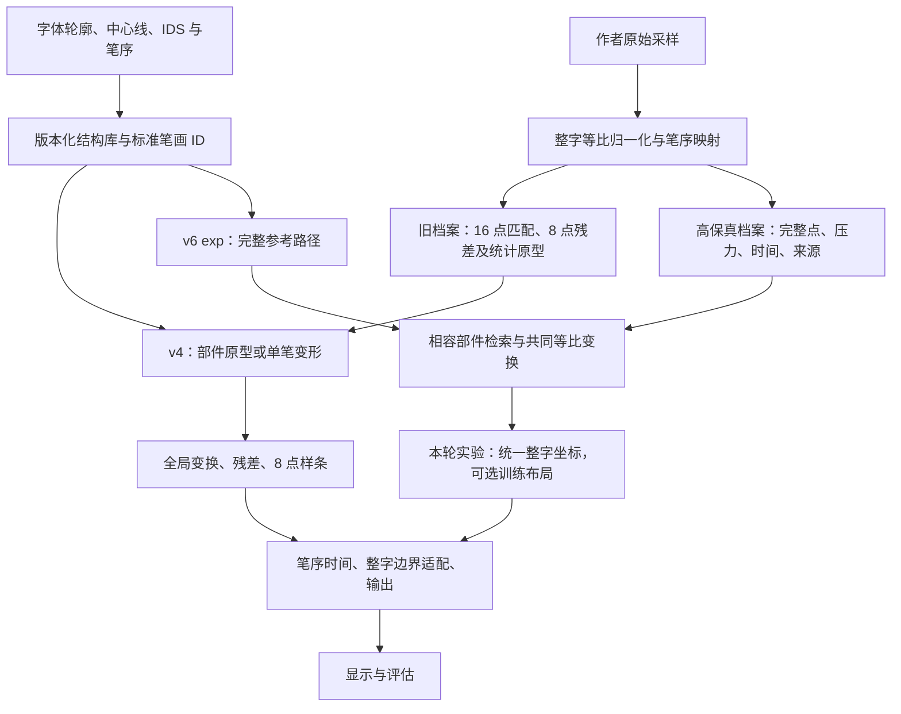

# 生成架构复核与拆层实验

日期：2026-10-11。分支：`codex/architecture-review`。基于 `ec4291b` 的 v6 exp 继续实验。判断依据为实现、真实输入和结果，不以实现者或模型版本作为质量依据。生产默认、上游结构、已有档案和输出均未修改。

## 结论

目前最值得保留的是**可追溯的标准笔画身份、可靠采样映射、完整轨迹、部件一致变换和输出契约**。需要改进的是**坐标约定、分层变形的责任边界、原型选择和质量评价**。固定 8 点、平均形状和无条件 B-Spline 都不是不可替代的必要条件；但本轮不支持简单删除全部布局、残差或部件风格。

实际完成 4 位作者、15 条路径、92 个作者—字组合的生成，共 1,380 份独立输出。有效原稿评估为 38 个作者—字组合、40 份采样。完整轨迹加统一字框，相对公平 v4 基线的作者等权几何误差减少 5.72%；加入训练布局后减少 6.24%。**这不是总体质量提升百分比**：一位作者退步，末端方向平均误差更大，原稿映射失败的样本未进入逐笔评估。尚不能全面替换 v4。

## 1. 实际运行架构

### 默认入口与可选路径

`generate_run()` 未传 checkpoint 时使用 `DeterministicGenerator`；部件模式默认 adaptive、强度 1。源轨迹默认 `legacy`。神经网络、源轨迹、源层修正、端点修复、布局风险分类等不是默认全部串联起来的流水线。应区分“仓库里存在的实验”和“生产实际执行的步骤”。本轮没有继续扩展风险分类模型。



### 每一层的真实职责

| 层 | 目前实现与事实 | 复核判断 |
| --- | --- | --- |
| 标准结构 | `structures.py` 导入字体 medians、笔序和分解；并非作者手写真值 | 必要的内容骨架，但必须允许可追溯修正，不能自动当成风格目标 |
| 数据归一化 | `alignment.py` 将实写整字等比缩放到最大跨度 0.85、居中；完整源通道另外保存 | 必要；参考坐标必须明确转换到同一约定 |
| 笔序映射 | 纠正可识别错序，排除歧义或不完整映射；完整源要求一对一 | 必要；不能为了扩大覆盖而强配。合笔、拆笔作者会被大量排除，这是现阶段能力限制 |
| 旧档案 | `profile.py` 产生全局比例/倾斜、部件布局、关系、单笔几何、单笔残差和整部件 8 点原型 | 有用信息与冗余变形混在一起，应拆成独立的布局统计和形状实例 |
| 整部件路线 | 多笔共享部件框，但笔形是多个实例的平均 8 点与参考的混合 | 相比逐笔互不相关的残差有价值；完整单实例或代表实例是替代方向 |
| 单笔路线 | 参考 8 点 → 部件框/关系变换 → 单笔框/端点变换 → 全局变换 → 通用/部件残差 | 多层都可能改变同一位置或幅度；端点重复位移已有明确案例 |
| 解码 | 对 8 点做 B-Spline，再采样 24–128 点 | 增加输出点数不恢复已丢失的折点；平滑是几何变形，不是只让画面显示细腻 |
| 动态通道 | 压力插值，按输出标准笔序分配时间、笔间隔 | 保留输出协议；没有观测动态时不得声称还原作者力度/速度 |
| 边界适配 | `canvas_boundary.py` 对整字作共同缩放和平移，避免逐点裁剪 | 必要的最后防护，不能用它掩盖上游变形错误；严重适配需保留复核记录 |
| 显示 | SVG/PNG 和本轮对照图以固定线宽画折线 | 轨迹、笔刷、页面布局是不同层；当前图不能验证压力风格 |
| 评估 | ID/笔数/时间等协议，几何距离、末向、交叉和人工标记 | 必须保留；协议通过不等于好看，字体差异也不自动是错误 |

## 2. 已证实的问题与尚待验证的风险

1. **坐标约定未统一。** v6 原稿通道采用 0.85 居中，而上一版参考回退直接采用字体坐标。仅在评估时整字对齐会掩盖这个问题。本轮在生成时只读取公开参考框，做同一约定转换，已经产生明显收益，不需要读取目标原稿。
2. **8 点限制发生在样条之前。** 直接停用样条仍输出旧 8 点折线的再采样。“荡”第 7 笔原参考有 21 个点，之前固定来源实验显示压缩加样条最大局部偏差约 0.0814 字框、末向差约 30.5°；只关样条无法还原丢失的点。见既有 `V6_EXP_20261011.md`，该数值属于表示诊断，不是作者相似度。
3. **端点几何重复作用已有明确反例。** 对单笔先变框再单独推端点会把短横弯成碗形；已有 `ControlRepairGenerator` 改为端点一致变形。本轮重测，平均几何变化小，但末向及部分交叉提示改善。它不能同时解决候选不相容和笔间连接缺失。
4. **“exact”不表示同样写法。** 旧通用键由方向/折数/形态签名和结构路径组成，可把不同部件的复杂笔画混用；少数样本也可能得到完整残差权重。平均会抹平不同写法，单个实例也可能选错，因此“完全不平均”不是候选质量的充分条件。
5. **关系数据不是连接约束。** `_relations()` 的 `intersects` 来自包围盒重叠，`touches` 来自包围盒间距不超过 0.025；既非实际折线相交，也非明确端点接触。这些图关系未作为 v4 的硬几何约束。`component_relations` 则是另一套相对框统计。不能把二者混称为已实现拓扑保护。
6. **神经置信度的语义和部署门槛不一致。** `train.py:episode()` 的目标是 `exp(-5 × 目标残差幅度均值)`，并非模型预测正确概率，更不是人工喜好。`_calibrate_confidence_threshold()` 以“零残差参考”作为拒绝预测后的误差；部署实际回退到完整 v4，且可能混合神经与记忆轨迹。校准时与部署时不是同一个策略。该结论来自静态代码核查；本轮没有证明它单独解释所有 v5 负面结果。
7. **神经模型仍共享 8 点瓶颈。** 增加编码器/解码器层数或 refinement 不能恢复从训练标签中已删除的角点。CASIA 数据没有真实压力和时间监督；现有几何损失、曲线/端点/切向/曲率、SDF 损失并不等于已经学到可验证的动态笔触。
8. **实现存在可收敛的复杂度。** 整部件原型命中后，单笔原型选择与残差计算仍会先执行，再被整部件结果覆盖；这是可做输出逐项一致验证后跳过的工作。本轮未修改默认逻辑。关闭部件残差时 92 字中 87 字几何完全不变，提示这层在当前档案覆盖下边际作用小，但不是证明全库都可删。
9. **版本与数据契约不完整。** 高保真 v6 检查逻辑结构哈希；默认旧生成入口主要检查作者 ID，没有与 v6 等价的结构内容哈希硬拒绝。修改参考后沿用旧原型应显式命名为结构实验 B，不能静默当成一致档案。神经风格 token 还存在建档取前 256、生成取前 96 的顺序偏置风险，尚未做本轮单独消融。

## 3. 必要性实验：不是看代码复杂就删除

### 固定协议与范围

- 4 位作者各按固定字符哈希预选 12 个字，仅用字符和公开笔数（3–20）筛选；11 个旧开发/保护字另列。所有目标字的重复采样在训练、建档、检索前整体排除。
- 每位作者用完全相同的合格训练采样建立 A 和完整源档案。没有把目标原稿混入 v4 基线。训练完整源规模依次为 767、431、779、322 份；最后一组含重复字，248 个不同字。
- 不作参数搜索。保留既有候选门槛，新字框固定跨度 0.85；学习层至少 8 个训练字，每字先合并重复，再取 3 参数中位数；比例限制 0.75–1.25，字心位移范数上限 0.15。
- 输出全部冻结后才读取目标原稿几何。48 个预选作者—字组合中 10 个无法可靠逐笔映射，最终 38 个组合、40 份原稿；各作者有效数为 11、5、12、10。尤其第二位作者剩余 5 字，属于明显选择局限。
- 这些是固定分组验证和历史回归，不是声称从未看过的新盲测；没有足够独立数据支持显著性、总体错误率或新的自然变化统计。
- 几何评估用统一弧长积分步长 0.003 比较折线，不重采样交付轨迹。先按笔等权、再合并同字重复、再按字、最后按作者等权。末向用末端局部弧长窗口；短钩为启发式诊断。弧长越接近原稿不自动表示更好，原稿可能有噪声。

### 逐层关闭结果

以下变化均相对重新建立的同训练样本 v4 A，负值表示这个几何指标降低。每次只关闭指定作用，其他路径固定；存在分支替代与非线性相互作用，不应把各行贡献直接相加。

| 路径 | 几何误差 | 相对 A | 判断 |
| --- | ---: | ---: | --- |
| A：v4 adaptive | 0.044995 | 基线 | 保留可重复基线 |
| 去整字全局变换 | 0.081214 | +80.50% | 整体布局必要；不代表旧公式每项都正确 |
| 去部件布局 | 0.046006 | +2.25% | 有贡献，不宜整体删除 |
| 去部件关系位移 | 0.045490 | +1.10% | 有小幅贡献；需与布局层合并建模，避免重复 |
| 去单笔几何 | 0.045439 | +0.99% | 坏字上有益不等于全局有益；优先修公式 |
| 去通用残差 | 0.045414 | +0.93% | 21/38 组合改善但整体略退步；宜选择性门控 |
| 去部件残差 | 0.044975 | −0.04% | 当前作用小，87/92 字几何不变；需更大覆盖验证 |
| 去整部件原型 | 0.045281 | +0.64% | 末向误差从 16.64° 到 22.06°，不宜退回全逐笔 |
| 只去 B-Spline | 0.044806 | −0.42% | 平均收益很小，仍有 8 点损失；不能当完整轨迹方案 |
| 已有端点一致修复 | 0.044918 | −0.17% | 值得机制性保留，不能声称全面修复 |

去通用残差后，相对参考出现额外交叉的字从 27/92 降到 6/92，但末向误差变差；去整部件原型则增至 38/92。**这些是几何提示，不是对应数量的确认坏字。** 不能只优化一个交叉计数就把作者写法拉回字体。

### 新替代方案：保留笔形，只统一坐标

新增 `glyph_frame_exp.py`，完全独立于生产入口：

1. V6：既有完整作者部件或完整参考回退。
2. V6_frame：根据公开参考的整字框，做一次共同等比缩放和平移，匹配采样坐标约定。
3. V6_learned：用训练字估计一个作者共同的正等比比例和平移，接在统一字框后；目标原稿不参与。
4. M_frame：锁定 V6 的候选、部件变换和字框，再恢复 16/8 点压缩与样条。没有原型平均，故只隔离压缩/样条，不隔离平均的影响。

| 路径 | 几何误差 | 相对 A | 末向误差 |
| --- | ---: | ---: | ---: |
| 完整参考原坐标 | 0.087808 | +95.15% | 22.03° |
| V6 原字框 | 0.087025 | +93.41% | 22.10° |
| V6_frame | 0.042420 | −5.72% | 22.23° |
| V6_learned | 0.042186 | −6.24% | 22.21° |
| M_frame | 0.042556 | −5.42% | 19.06° |

| 匿名作者（映射保留在本地报告） | 有效字 | A | V6_frame | V6_learned |
| --- | ---: | ---: | ---: | ---: |
| W1 | 11 | 0.04251 | 0.04114 | 0.03749 |
| W2 | 5 | 0.05211 | 0.05760 | 0.05978 |
| W3 | 12 | 0.03645 | 0.03221 | 0.03313 |
| W4 | 10 | 0.04891 | 0.03874 | 0.03835 |

主要收益来自统一坐标约定；额外学习层相对固定字框仅改善约 0.55% 均值，且两位作者退步，暂不值得默认增加这层。A 与 V6 的候选及表示不同；M 与 V6_frame 才是固定来源的表示对照。M 的末向指标更好说明平滑并非一概有害，也可能让字体参考更接近圆转作者写法；这不是它保留了输入短钩的证明。

v6 共接受 78 个完整作者部件，267 笔、12,312 个作者点保持精确来源变换；其余笔使用完整参考。两种新增整字变换不改变候选、不移除点、不平均笔形，保留压力与输出时间，正等比变换保持每段方向和交叉集合。共同字框有 2 个越界提案被拒并完整回退，训练字框本次无越界回退。所有 1,380 份输出无协议失败、无严格零长度；**这不排除原结构近空笔、粗笔碰撞、开口和拥挤**。

本机每字生成中位时间约 A 2.6–2.9 ms、去样条 1.3–1.7 ms、v6 9.6–10.6 ms；整字后处理另约亚毫秒。仅是当前小集、温缓存、串行计时，包含不同检索开销，不是专门性能基准；完整点路径并非自动更快。缓存检索锚点、先廉价排序后验全轨迹值得保留。

## 4. 四个历史问题字与保护范围

本地报告包含而、相、儒、荡同尺度整字图和局部放大，另外展示每位作者几何改善最大、退步最大的留出实例以及叵保护例。例图属于结果后挑选的说明，汇总仍使用全部有效原稿。

- 而：只关样条仍保留残差拉宽的控制网；完整参考保住折角，但不是作者原稿。下部本来开口，不应强行补底边。
- 相：框线与底横间隙涉及候选、端点和笔间接触；光换平滑器不足。需要区分字体的预期连接与作者允许的开口。
- 儒：验证嵌套结构后能用雨部实例；下部而仍可能参考回退。候选覆盖与表示保真是两项独立贡献。
- 荡：第 7 笔折点需要完整轨迹或显式锁点，增加样条输出密度不能弥补。当前完整路径可能更楷体化，不能以“更方”代替“更像作者”。

四字没有用于本次风格验收的作者目标原稿。叵的历史好评只适用于原来的资产，不自动继承到重建档案和新算法输出。粗笔、终端方向、局部长度与候选记录保存在本地逐笔数据中；单靠平均几何误差无法验收审美。

## 5. 结构正确性仍在生成架构之前

本轮固定原结构库以避免混入修结构的收益，未再次称“全库修复完成”。先前审计已发现导入裁剪信息丢失 6,012 笔及 3 个确认中心线缺陷，独立修正层合计 6,015 笔；还有端点/钩歧义和 485 字未决映射。见 `STRUCTURE_AUDIT_REPAIR_20261007.md`。

完整保留一条错误参考线，只会忠实继承错误。本轮原 v6 的黧第 1 笔弧长仅 0.00403、瀝第 6 笔仅 0.00840 字框单位，去平滑和新字框均未解决近空源路径。修正参考、只换生成参考、重新建档必须继续分别比较，结构哈希应成为统一契约；不能把新的坐标层与旧修正层随意叠加后归功于 v6。

还有一个接入次序冲突：已有修正层有意允许参考 y 大于 1，以恢复字体原坐标；`FullReferenceGenerator` 却在中间参考阶段执行最终输出的 `[0,1]` 检查，新字框后处理还未运行就会拒绝这类输入。应将坐标适配放在正确的阶段，再检查最终输出；在此之前，本轮实验层不能被称为与全部结构修正已兼容。

## 6. 论文与开源项目：吸收原则，不冒充复现

本轮阅读原作者论文与官方实现，没有下载权重、上传个人数据或在 Mac 上运行这些模型。以下为外部方法事实与本项目推论的明确区分。

| 一手来源 | 核对到的方法 | 对本项目的可迁移启示与边界 |
| --- | --- | --- |
| [SDT，CVPR 2023 论文](https://arxiv.org/html/2303.14736v2)、[官方代码](https://github.com/dailenson/SDT)、[model.py](https://raw.githubusercontent.com/dailenson/SDT/master/models/model.py) | writer/glyph 双风格头及两种对比目标；按点自回归，GMM 位移与笔状态；官方实现分开两次注意力解码 | 支持区分整字共同风格与局部细节。本轮只检验该分层思想的低维实现，并非 SDT 复现。其自由序列不能直接保证我们的标准笔画 ID/笔数；论文中文训练约 370 万字、1,020 作者，也不能等价于当前个人样本规模 |
| [LF-Font，AAAI 2021 官方实现及论文入口](https://github.com/clovaai/lffont) | 组件局部风格与因子分解，离线字体图像生成 | 启示是部件身份应进入形状表示，通用笔画签名不够；不直接提供我们的在线轨迹、时间或笔序保证。图像生成指标不能与本轮曲线指标直接比较 |
| [DeepWriting，CHI 2018 作者项目与论文](https://ait.ethz.ch/deepwriting) | 内容与风格分离的数字墨迹编辑/合成 | 支持内容、风格、编辑控制拆层；其场景和标注不等价于严格中文结构库，不能原样替换 |
| [Make Me a Hanzi 官方数据说明](https://github.com/skishore/makemeahanzi) | graphics 来自字体；轮廓、中心线、笔序和分解匹配是不同字段，分解允许未知项 | 验证了“参考是字体而非作者真值”。应该保留源轮廓与坐标语义，不用压缩控制点取代源数据 |

已有本地历史 v5 正式验证也须纳入判断：`V5_IMPLEMENTATION_AND_PRELIMINARY_RESULTS.md` 中安全模式 59 字全部回退，强制神经生成反而劣于 v4；这是历史结果，不是本轮 Mac 重跑。当前 Hybrid 入口硬要求 CUDA，本机实验没有执行神经推理。应先校准实际部署策略和重设计表示，再投入大模型训练；不以“有 Transformer”判断架构先进程度。

## 7. 保留、去除、替代、改进的具体决策

| 决策 | 项目 | 可执行边界 |
| --- | --- | --- |
| 保留 | 标准 ID/笔顺、映射审计、完整源档案、哈希、分组留出、回退记录 | 是内容正确性和实验可信度基础，不做破坏性消融 |
| 保留但校正 | 整字坐标与部件布局 | 统一语义；整体比例必要，布局不应在多层重复累计 |
| 从完整轨迹路径去除 | 固定 16/8 点交付压缩、多个实例形状平均、强制 B-Spline | v6 已能绕过；16 点仅用于匹配估计可保留，不应等同于输出压缩 |
| 替代 | “任何原型都先平均” | 相容完整实例优先；代表实例/分簇多原型是未验证的下一候选，不能直接宣称更好 |
| 可选替代 | 为节省点数做简化 | 复用已有带误差上限、端点/折点/末钩保护的简化；最终变换后复核误差，不再统一回 8 点 |
| 优先修正 | 单笔几何端点重复位移、稀疏复杂残差 | 复用已验证修复而不是全局关掉个性化 |
| 合并责任 | 部件布局与关系位移 | 用一个最终目标框或共同变换表达；先做固定候选下的消融，不叠更多补丁 |
| 可删的计算 | 整部件已命中后被覆盖的通用残差运算 | 需单独做全输出完全一致验证后合入；本轮只定位、未改默认 |
| 暂不默认加入 | 新训练整字布局、更多风险分类层 | 本轮学习层收益不稳定；复杂度暂不值得 |
| 改进评价 | 连接间隙、粗笔碰撞、折点/钩、独立作者风格与人工复评 | 现有置信度、交叉提示、同源编码器相似度均不能独立代替质量验收 |
| 后续重构 | 神经置信度与表示 | 用实际部署输出相对实际回退的收益作校准目标；未来预测有界共享布局/形变，或保折点可变长轨迹 |

## 8. 建议接入顺序与剩余证据

1. **首先固定坐标与版本契约。** 明确 source/reference/canvas 三种坐标，结构修正保持版本化。统一字框层可作为 v6 的显式实验选项；先不修改旧字形。
2. **保留可追溯实例，扩大相容部件覆盖。** 优先验证嵌套部件和来自其他字的完整部件；不以逐笔混搭提高覆盖。对不能可靠映射的合笔/拆笔另建模型，不能隐性降低门槛。
3. **布局与形状解耦。** 相容作者部件只接受一个共同变换；无来源保留参考折点。作者整体比例、宽高比和倾斜若需要学习，分别试验，不混入等比主结果。
4. **接触约束单独建证据。** 明确端点到笔段的期望关系及作者容忍范围，再考虑共同形变或候选重选，不靠放大样条掩盖断口。
5. **最后才考虑神经残差和笔刷。** 修正校准契约、使表示不强制 8 点；显示压力需要单独的有观测标定的笔刷，不应改变轨迹来模拟线宽。

全面接入仍缺：足够的作者独立、未反复观察的留出原稿；mjb 等合笔/拆笔样本的可靠评价；笔刷与真实笔触标定；复杂钩和多分支中心线的可靠修正；保护字独立人工复评；分层交互消融；对实际部署回退策略的神经校准。当前结论适用于本地有限样本，不应外推全库。

## 9. 复现与交付

```bash
.venv/bin/python scripts/run_architecture_review.py --output artifacts/architecture_review_20261011/new_run
.venv/bin/python scripts/report_architecture_review.py --run artifacts/architecture_review_20261011/new_run
QT_QPA_PLATFORM=offscreen .venv/bin/pytest -q
```

输出目录必须不存在。已执行实验位于 `artifacts/architecture_review_20261011/run_v1/`，本地图文报告为其 `report_final/报告.html`（补充了近空笔局限，保留初版 report）。协议记录输入与代码哈希；每位作者有独立训练索引、档案、来源、排除、变换、回退和原稿评价。全部私人轨迹和图文受已有 `artifacts/` Git 忽略规则保护；提交仅包含实验代码、测试与此脱敏结论。既有未提交的编辑器、页面布局等工作不纳入本轮提交。

验证：完整测试 226 passed、4 skipped；新增 3 项测试验证整字变换的点/动态/交叉保持、同字重复等权与目标排除、稀疏证据和越界回退。新增代码 Ruff 检查通过。代码未导入生产默认入口。
