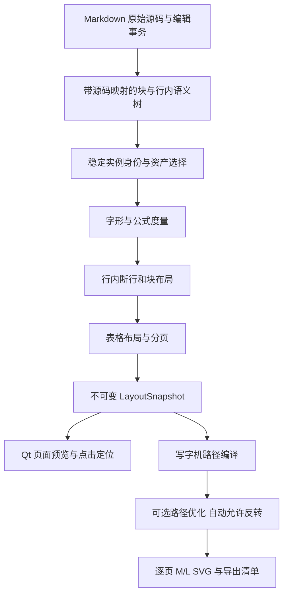

# Markdown 多元素混排详细实施计划

日期：2026-10-13。状态：**目标模式实施中；M0–M3 已完成；M4-01 与 M4a–M4c 手写公式已实现，代码块已实现，外部后端试验已完成，实样校准待资源同步；继续推进 M5；M5–M6 保持原定范围**。

实际进展与验证见 [实施记录](MARKDOWN_MIXED_LAYOUT_PROGRESS_20261013.md)。

本计划描述分阶段交付；实际已实现范围以实施记录为准，未勾选的正文混排、手写公式、复杂表格或模板能力不能视为已经实现。计划以当前工作区源码为依据，吸收 2026-10-12 数字表格的真实样本和写字机试用结果；最初 Word 提案属于参考材料，用户后续确认的尺寸、反转策略和输出规范优先。

## 1. 交付目标与默认决策

建立一个以 Markdown 源码为内容权威的双栏应用：左侧编辑源码，右侧实时显示真实物理尺寸的分页手写页面。标题、正文、列表、引用、表格、公式等通过统一布局内核排版，最终可导出每页只含 `path`、且路径指令只含绝对 `M/L` 的写字机 SVG。

本轮沿用的明确决策：

| 项目 | 决策 |
| --- | --- |
| 编辑方式 | 左侧源码、右侧页面预览；先保证源码编辑与定位，不立即实现任意页面拖拽式编辑 |
| 内容模型 | Markdown 是唯一可写正文；语义树、分页结果、路径顺序均为派生数据 |
| 表格默认 | 表宽 160 mm，行高 8 mm，数字区域高度 3.8 mm，格内留白 0.3 mm |
| 数字区域高度 | 是整套数字度量区域的高度，不强行把每个数字或小数点拉到 3.8 mm |
| 正文默认 | 先保留现有正文 6 mm em、9 mm 最小行高，避免把数字表格参数套到汉字正文；混排实测后单独校准 |
| 页面默认 | 首个混排配置采用 A4、四边 20 mm；160 mm 表格在 170 mm 内容区居中。独立表格工具保留现有 15 mm 页边距，不因整合改变旧项目 |
| 选样 | 每字多份样本稳定抽取，保存实际 sample ID；重排、预览缩放、导出优化不得触发重新选样 |
| 路径优化 | 开关默认保持现有“关闭”；一旦开启，自动允许反转，不再提供独立反转取消项 |
| 写字机输出 | 每页一个独立 SVG，毫米坐标，所有非根元素均为 `path`，只含 `M/L`，不夹带白底、占位框或评价色标 |
| 兼容方式 | 纯文本检查器、独立表格工具继续可用；逐步共享内核，保留 `.inkreview`、`.inktable` 读取与另存 |
| 实施节奏 | 先做正文与表格混排闭环，再扩展符号、公式、图片和复杂模板；每阶段有可运行产物和停止条件 |

“支持某个 Markdown 元素”分为四项：**识别源码、正确布局、可信预览、可正式写字机导出**。验收报告分别列出四项，不以解析成功代替排版或书写能力。

## 2. 当前事实与缺口

### 2.1 已核对的工程基线

本次检查的分支为 `codex/quality-roadmap-20261012`，HEAD 为 `8959ebb`。工作区另有未提交的排版、采集及其他开发内容，因此 HEAD 不能代表本计划所依据的全部代码。本轮不清理这些更改、不切换分支、不提交或推送。关键文件哈希保存在忽略目录 `artifacts/markdown_mixed_plan_20261013/source_snapshot.json`。

2026-10-13 当前工作区完整测试：**293 passed、4 skipped，约 6.08 秒**。这是已有功能的回归基线，不是新混排功能的通过证明。

| 已有模块 | 当前可复用能力 | 需要补充或改造 |
| --- | --- | --- |
| `document/schema.py`、`document/source.py` | Document/Node/Occurrence、scalar 源范围、UTF-16 转换、保守集群分段 | Node 目前是段落列表；需支持嵌套块、行内树、标记来源和跨编辑身份 |
| `assets/glyph_provider.py` | 汉字轨迹只读适配、原始 JSON、哈希身份、外部度量 | 目前按字符映射到单个资产；需提供多候选、符号样本、能力声明和固定选样 |
| `layout/plain.py` | 中文禁则子集、断行、多页、完整覆盖检查、作业键 | 需引入可测量行内盒、嵌套块、表格与公式；覆盖检查不能仍只按“一次出现一个片段”判断 |
| `scene/schema.py` | 不可变页面、片段、绘制操作、诊断 | 需区分语义实例、页面片段、机器笔画；增加基线盒、来源和重复表头角色 |
| `editor/app.py`、`editor/review.py` | 原生输入、延迟后台排版、过期任务拒绝、双向定位、人工字形评价 | 目前纯文本；需 Markdown 模式、语法诊断、块导航、稳定身份与项目资源管理 |
| `renderers/pages.py` | SVG/PNG 共用页面快照、失败发布保护 | 普通页面 SVG 含 `rect/polyline/circle`，调试时还有 `text`；**不能直接当写字机 SVG** |
| `table_editor/core.py` | HTML 表格网格、跨行跨列、共边去重、毫米布局、严格 M/L 导出 | 单元格目前只允许数字/小数；需支持行内内容、换行、分页、内在宽度及源映射 |
| `table_editor/samples.py` | ZIP 只读导入、数字和小数点、固定种子、原始点保留 | 需统一到一般符号 provider；现按出现序号抽样，插入前文会改变后续选样 |
| `table_editor/routing.py` | 最近邻、空间候选、方向动态规划、整段翻转、旧结果兜底 | 需从表格包移为通用页面服务，并保留语义顺序和路径身份映射 |
| `symbol_capture.py` | 数字、英文、希腊及数学符号采集任务，变量笔数，每字默认 5 份 | 采集能力不等于资源覆盖；实际资源缺口要从导入样本清单生成 |

当前 `pyproject.toml` 未声明 Markdown 或数学排版依赖，本地环境也未安装 `markdown_it`、`mdit_py_plugins`。不得把原设计里的依赖候选写成已经接入。

### 2.2 本次表格经验应转成通用约束

1. **毫米尺寸由一个配置对象给出。** 表宽、行高、字高、留白不能分别硬编码在界面、CLI、项目文件和示例脚本。新建默认值统一读取，旧项目尺寸照常恢复。
2. **长数字应保留字符串。** `0.00`、`001`、`1.9751` 不能经数值类型来回转换；科学计数法也保留源码精度，不进行自动数据计算。
3. **布局用实际选中的样本测量。** 先选样再计算 advance 与 ink bounds；不能先以平均字宽排好、最后换入另一个较宽样本。
4. **小数点和下伸符号不能单独撑满字框。** 当前依据 guides 的公共尺度有效，必须升级为有版本的作者度量配置，而非随资源包新增字符重新计算整套尺度。
5. **新默认值不是所有内容的硬上限。** 8 mm 对简单数字表格是默认行高；复杂公式或多行单元格默认按内容增高。固定实验模板必须明确设置固定行高，放不下就报错。
6. **预览几何和执行顺序独立。** 路径优化不得改变选样、字形几何、文本顺序、评价归属或源码定位。
7. **默认优化允许反转已获本次实测支持。** 该策略直接用于后续机器导出；不得重新增加“是否反转”的普通用户确认步骤。
8. **距离收益不等于真实耗时收益。** 当前 v2 相对旧算法在 5 张表上再减少总空行程 13.4%，约 236–240 条路径的宽表计算约 0.11–0.12 秒；这些是已记录固定样例结果，尚非全文档性能保证。
9. **按能力失败要比丢内容更明确。** 此前标题格留空是用户针对一次数字导出的明确选择；新混排工具不得默认删除标题、公式或图片来得到“成功”结果。
10. **人工评价跟随资产哈希。** 未标记不等于“好”；扩展英文、数字、符号评价时沿用同一原则，不把自动几何诊断变成人工质量标签。

最初补录包有 28 个字符、140 份样本。2026-10-13 新同步 `user_001符号录制.zip`，现已验证 80 个字符、405 份样本：数字与数学/标点各 5 份，小数点 10 份，仍没有英文和希腊字母。完整样本与公式混排证据见 [新符号验证](SYMBOL_VALIDATION_20261013.md)；其他作者资源与人工标定不由此推定完成。

## 3. 总体架构

解析器不决定页面坐标，字形提供者不决定页码，分页器不解析 TeX，优化器不修改文档或字形资产。表格是块布局中的一种容器，不再自行拥有一套与全文隔离的最终页面。

### 3.1 模块拆分与兼容入口

以下未存在的路径均为**拟新增模块**，不是现成接口。

| 模块 | 职责 | 迁移与依赖 |
| --- | --- | --- |
| `document/markdown.py` | 固定方言解析、块/行内节点、诊断 | 复用原始源码缓冲；不直接生成 HTML 截图 |
| `document/source_map.py` | 源标记、实体、转义与显示内容映射 | 复用 scalar/UTF-16 转换，保留 CRLF 映射 |
| `document/identity.py`、`editing.py` | 编辑事务、节点/实例 ID 迁移、撤销恢复 | 服务于持久选样和后续局部覆盖 |
| `assets/symbol_provider.py`、`resolver.py` | 汉字与符号入口统一、候选选择、缺字清单 | `table_editor/samples.py` 保留兼容包装 |
| `layout/inline.py`、`blocks.py` | 可测量盒、中文/西文断行、标题/列表/引用布局 | 保留 `plain.py` 的兼容入口和回归样例 |
| `layout/tables.py`、`pagination.py` | 网格测量、合并约束、单元格内容、跨页续排 | 迁移已验证的共享边框算法 |
| `math/schema.py`、`provider.py`、`handwritten.py` | 受控 TeX 数学树、数学盒、手写符号与规则线 | 依赖统一资产和盒子接口，不反向依赖 Qt |
| `plotter/schema.py`、`compile.py`、`routing.py`、`svg.py` | 机器笔画契约、校验、排序、严格导出 | 将 v2 算法迁出表格包；旧导入路径转发 |
| `document/package.py` | `.inkdoc` 保存、资源索引、恢复与迁移 | 读取 `.inkreview/.inktable` 后另存新格式 |
| `editor/app.py` 与新增组件 | 模式切换、预览、诊断、属性面板 | 复用输入法与异步发布机制，避免复制第三套窗口逻辑 |

先提取公共服务再替换调用方；不得直接删除独立表格应用。每次迁移以同一输入产生同样的未优化几何为验收门槛。

### 3.2 权威数据与派生数据

| 对象 | 核心字段 | 不变量 |
| --- | --- | --- |
| Document | document ID、revision、source、dialect、seed、样式与页面配置、资源清单版本 | source 是正文权威；revision 单调递增 |
| Node | stable ID、kind、children、source spans、attributes | 不以当前行号/页号当 ID；未知内容保留 |
| Occurrence | stable ID、node ID、覆盖源码、显示文本、角色 | 独立于当前页面，复制粘贴创建新 ID |
| SelectedAsset | occurrence ID、provider、asset/sample ID、hash、metrics version、selection version | 已确认的选样可恢复；资源更新不能静默替换 |
| LayoutBox | width、advance、ascent、descent、baseline、ink bounds、合法断点 | 布局依赖度量，不反复扫描原始采样点 |
| Fragment | fragment ID、source occurrence/node、页面、局部到页面变换、角色 | 同一内容可生成多个片段，例如重复表头、跨页段落 |
| PlotStroke | stroke ID、source fragment、毫米点列、笔配置、执行域 | 源笔画分段、点数和来源可追溯；优化时只改顺序/方向 |
| PlotPlan | snapshot hash、route version、start、ordered stroke IDs、reverse flags、cost | 是派生输出，不能写回源笔顺或改变压力/时间 |
| ExportManifest | revision、输入/资源/度量/算法哈希、逐页状态、路径数、距离、警告 | 每次导出完整冻结一个 revision |

快照版本与项目格式版本分别管理。旧格式无新字段时显式迁移；未知未来主版本不得按旧规则覆盖写入。

## 4. Markdown 元素支持矩阵

阶段编号见第 11 节。矩阵是交付顺序，不是当前支持清单。

| 元素 | 首次计划阶段 | 布局与书写规则 | 边界与验收重点 |
| --- | --- | --- | --- |
| 普通段落、空行 | M2 | CJK/非连写拉丁横排，段距、首行缩进可配置 | 空白有来源；不把一个换行一律变成新段落 |
| softbreak / hardbreak | M2 | 软换行按方言折叠；中文相邻不插空格，其他文本按规则插空格；硬换行强制换行 | CRLF、尾换行、双空格硬换行及转义边界 |
| H1–H6 | M2 | 版本化字号/段距，默认 keep-with-next | 标题不能孤立在页尾；未知大字资产不能借系统字体伪装 |
| 有序/无序列表 | M2 | 悬挂缩进、嵌套、起始编号保留，编号参与度量 | 跨页编号不重置；长编号和嵌套宽度不足可定位 |
| 引用块 | M2 | 缩进与单线引用边线，内容正常分页 | 嵌套引用；跨页边线片段不重复描画 |
| strong / emphasis | M2 | 保留语义，首版手写强调配置用单线下划线表达；需要更强区分时使用明确样式预设 | 固定笔不能因 SVG stroke-width 改变就被声称会写出粗体；不默认倾斜/描边原笔迹；样式变化进入度量键 |
| 删除线 | M2 扩展 | 基于字高生成横线，每行独立处理 | 线属于装饰路径，不能删除原文字；代码内标记不解释 |
| 水平分隔线 | M2 | 使用页面内容宽度或配置宽度的单条折线 | 段距与页尾处理；不输出 `line` 元素 |
| 链接、自动链接 | M2 | 绘制可见标签或实际裸 URL；链接目标保存，不自动访问 | 定位标签与目标分开；写字机不承诺点击能力 |
| 行内代码 | M2 | 文本原样，采用固定 advance 的代码风格；不执行 | 字形必须存在，空格和反引号边界准确，不能靠浏览器字体回退掩盖缺字 |
| 围栏/缩进代码块 | M4 | 保留空白，版本化 tab stop，按行分页 | 先不做彩色语法高亮；宽行默认报错，显式开启换行时标识续行 |
| 管道表格 | M3 | 一行表头、列对齐、inline 子树、内容驱动测量 | 转义竖线、代码/公式内分隔符按固定方言处理；不承诺所有扩展解释方式 |
| HTML 表格 | M3 | 只允许受控 table/thead/tbody/tfoot/tr/td/th 与布局属性 | 保留现有 rowspan/colspan；拒绝脚本、事件、任意 CSS 和嵌套表格 |
| 行内数学 | M4 | 数学盒参与基线及行高，首版视为不可拆原子 | 超宽报错；不能把 TeX 命令逐字符当正文 |
| 展示数学 | M4 | 块布局，独立上下间距和居中/左对齐选项 | 首版不自动拆长公式，后续支持明确的对齐换行结构 |
| 脚注、参考编号 | M5 | 节点及引用稳定，脚注区域与正文分页协同 | 先预留接口；脚注连续挤占正文时必须保证分页前进 |
| 任务列表 | M5 | 方框/勾选符号由规则折线绘制，内容为普通列表 | 源码状态是权威；点击复选框只执行明确源码补丁 |
| 图片、图题 | M5 | 首先作为块盒预览，明确尺寸和长宽比；图题正常排版 | 栅格图仅预览，默认阻止写字机成品导出；跳过图片只能是一次明确导出选择并记录清单 |
| 已有单线 SVG 图 | M5 | 校验后换算毫米、展平允许变换、编译成折线 | 字体轮廓和任意填充不能冒充单线手写；曲线离散须独立声明容差 |
| Mermaid 等图示 | M5 后置 | 保留源码及扩展节点 | 未实现前显示诊断，不能只输出代码或空白并声称图已支持 |
| 定义列表、复杂块扩展 | M5 后置 | 按扩展逐一实现 | 未知语法保留，不由正则“尽量猜” |
| Obsidian WikiLink / Callout / 嵌入 | M5 后置 | 独立方言扩展，先支持有可见标签的静态表现 | 不扫描用户整个库、不自动展开递归嵌入；与普通 Markdown 模式区分 |
| 任意 HTML、JavaScript、LaTeX 宏包 | 不在本计划完整支持范围 | 保留源码并明确 unsupported | 不执行、不转成丢失部分内容的假成品 |
| 竖排、完整 RTL、连写脚本 | 独立后续项目 | 保留 provider 和方向接口 | 不宣称已有分段规则能够正确塑形 |

强调样式预设属于设计默认，需在 M2 样张中人工确认；它不修改 Markdown 中 strong/emphasis 的语义身份。未来有经校准的字形风格后可以替换样式映射，无需修改正文。

## 5. 解析、源码映射与稳定选样

### 5.1 固定方言与解析适配

沿用原方案，将 `markdown-it-py` 作为首个候选，以独立适配器隔离外部 Token。数学、表格及少量扩展只开启清单中的规则；版本在 M1 试验通过后精确锁定，不能引用“latest”作为可复现依赖。

官方文档的 Token 示例显示块级 map 和缺少 map 的行内 token；它不是现成的逐字源码映射。本项目需要补充规则级位置记录，不用 `source.find(token.content)` 推测重复字符串的位置。[解析器依据](https://markdown-it-py.readthedocs.io/en/latest/using.html)

源码映射应区分：标记区间、内容区间、实体或转义区间、不可见语法区间、派生内容来源。例如 `&amp;` 的可见字符对应整个实体源范围；列表编号可由列表语义派生，但必须能定位该项起始标记。早期公式允许整体定位到 TeX 区间，不承诺逐符号命中。

中文原始文本保留 Unicode 标识，不做全局兼容归一化。内联代码、代码块、数学、HTML 表格的解析边界先划清，再处理各自内容；不能先全文正则替换数学或竖线。

### 5.2 跨编辑身份与选样

现有表格种子以出现序号参与选择，只保证相同全文重排一致。混排需要以下规则：

1. 初次解析为节点与可书写实例分配不透明 ID，保存 selected asset。
2. 编辑事务给出旧区间、新文本和光标状态；未受影响区间通过位移映射保持 ID。
3. 局部受影响块用类型、上下文和编辑锚点匹配；相同文本的多个候选若有歧义，不把覆盖误挂到任意一个。
4. 新实例的选样键由 document seed、occurrence ID、provider 和资源池版本决定；既有实例优先读取已保存 asset ID。
5. 删除后的选样和覆盖随 undo 恢复；复制粘贴新建 ID；撤销分支不得复用已废弃的新实例身份。
6. 外部全文重载无法可靠匹配的实例成为待确认项。显式“重新选样”才更新选中范围的样本；新增字库样本不能让全文自动换字。
7. 每个页片段引用同一个源实例选择；重复表头共享选样，只生成新的 fragment ID。

验收必须包括：文首插字、重复段落中间插字、拆段/合段、跨表格编辑、复制、撤销和重开项目。不能仅测试固定 seed 后重复导出。

## 6. 字形与符号统一度量

### 6.1 三类提供者

- **GeneratedHanProvider**：适配已有生成字库，保留原始点、压力、时间及 up/end 几何端点。
- **CapturedSymbolProvider**：直接使用 Windows 符号采集样本，候选可有不同笔数；数学类别和作者信息保留。
- **ProceduralStrokeProvider**：提供表格边框、分数线、根号延伸线、下划线等明确的结构笔画；不能伪装成用户手写样本。

内置单线数字继续作为显式可选资源。普通字体轮廓或数学字体提供者可以服务参考预览，但必须标记 `plotter_ready=false`，不作为缺字时静默的写字机回退。

### 6.2 坐标与度量规范

页面统一毫米、左上原点、y 向下。采集点按**每份文件实际 guides** 转为作者 em 坐标；不能硬编码采集画布是 560×320 或 em=200，本次真实样本使用 420×240、em=150。

为作者或度量组持久保存 baseline、cap height、x-height、ascent/descent、math axis、advance 与附件锚点。度量校准有独立版本和 provenance，不改写原 JSON。字形绝对比例由组级度量决定，不能因单个字偏小就自动拉大。

当前数字包通过公共上下界得到的布局尺度应作为 `numeric_profile_v1` 导入并冻结。后续加入下伸字母、积分号等不能再用全库最高/最低点重新缩放全部数字；它们增加自己的行高需求。人工更新度量配置时才显式触发重排。

首批符号扩展顺序：数字/小数点 → 正负号和常用标点 → 英文大小写及单位 → 希腊与常用数学符号。ASCII `-`、数学 `−`、Greek 变体保持不同身份。资源缺口由正文扫描生成，不承诺五份样本已经涵盖所有风格。

### 6.3 基线、间距与墨迹

保留逻辑 advance 与实际 ink bounds 两套尺寸。空格可以只有 advance；汉字、数字、单位通过各自基线规则对齐，不按紧外接框居中。中文与西文间距、数字与单位之间的不可断规则使用有版本的配置。

行高按内容计算：

$$
A=\max(A_{\min},A_1,\ldots,A_n),\qquad D=\max(D_{\min},D_1,\ldots,D_n)
$$

$$
H=\max(H_{\min},A+D),\qquad b=y_{\mathrm{top}}+\frac{H-A-D}{2}+A
$$

笔宽是页面毫米值，不随字形缩放二次变粗。墨迹越界检查包含至少半笔宽及数值容差。实际设备的笔宽上限可由导出配置指定，不能用屏幕抗锯齿像素当毫米精度。

## 7. 表格升级：从数字工具到容器布局

### 7.1 保留实测能力

继续支持已有 HTML 的 rowspan/colspan 和公共边框合并；不因早期 Word 提案暂缓合并单元格而删除已完成能力。现有数字-only `compile_html` 可以保持严格入口，新混排适配器负责创建一般 TableNode。

本次实验文档中的 `cellpadding="6"`、表级居中样式需要**明确的兼容导入规则**：识别并转换为文档的毫米样式配置，或报告“忽略了源样式，已采用用户选定配置”；不悄悄当作完整 CSS 支持。尺寸默认遵从 160/8/3.8/0.3 参数，源码显式样式与面板覆盖的优先级写入项目。

### 7.2 宽度、行高与内容

首批一般单元格支持文字、数字、行内强调和后续行内公式。默认数字行居中，段落型多行单元格顶部对齐；可以设置水平与垂直对齐，不能复用“y 外接框居中”代替基线。

列宽支持等宽、比例、固定宽与按内容分配。先计算每列最小/首选宽度，再分配表总宽。不可断原子包括数字串、短单位组合和首版行内公式。跨列单元格形成区间宽度约束，单列分配完成后需要检查并确定性地补足区间，不能只取每列独立最大值。

行高默认 8 mm 是最小值，内容超过时允许增高；`fixed_row_height` 是独立设置。表格默认 padding=0.3 mm 保持用户确认值；数据模型从一开始预留四边独立留白，UI 可以先保持联动输入。横向溢出时报告位置及所需宽度，提供改字号/列宽/页面的建议，不自动把全表缩小。

小数点对齐作为单独列属性实现：按小数点两侧 advance 分配列内位置；无小数点的数值使用明确的整数锚点。不得修改小数位或给无小数点的整数补字符。

### 7.3 跨页与边框

1. 首版仅在行边界分页，跨行合并单元格覆盖的行形成不可拆行组。
2. 跨页表头共享语义身份及样本选择，页面片段标记为 repeated header。
3. 空页扣除表头后必须装得下至少一个正文行组；否则诊断超高组，不无限续页。
4. 跨页边框重新生成局部片段，不能连接上一页末点到下一页首点。
5. 边框去重只针对同一个表格网格的共同边，不对字形笔画做全局几何去重。
6. 跨页跨行单元格内部拆分、多段复杂单元格、嵌套表格放到 M5 后，不在 M3 强行扁平化。

## 8. 数学公式：优先解决真实书写结构

### 8.1 两种能力必须分开

原 Word 提案建议普通矢量公式先行。结合现在严格写字机输出需求，调整为：**公式语法/度量可评估外部后端；正式写字机输出优先实现受控手写数学子集。** 普通 MathJax SVG 只作为可选参考预览，不让它成为正文/表格混排首个可用版本的前置阻塞。

MathJax 官方文档说明 SVG 输出会使用字体路径缓存，`local/none` 可以帮助独立 SVG 输出；这不构成手写轨迹或笔顺保证。[输出选项依据](https://docs.mathjax.org/en/v4.0/options/output/svg.html)

即使把字体轮廓的曲线全部折线化并满足 M/L 语法，机器仍可能在描字轮廓。语法合格与单线书写质量是两道独立验收门槛，不能把前者当作后者。

### 8.2 数学语法与实现顺序

文件内行内公式采用 `$...$`，展示公式采用独立成行的 `$$` 分隔；代码块中的定界符不触发数学解析。数学源码保持原样，不进行整份 TeX 文档执行。

| 子阶段 | 内容 | 实现要求 |
| --- | --- | --- |
| M4a | 数字、标识符、希腊、单位文本、分组、常用运算符和关系符 | 用数学类别控制间距；一元/二元减号按上下文区分；缺符号列出资源需求 |
| M4b | 上下标、分式、根式 | 明确脚本缩放、偏移、碰撞和分数轴；规则线是独立折线 |
| M4c | 伸缩括号、求和/积分上下限、简单矩阵/分段表达式 | 默认专用几何构件；按用户补充要求，可显式选择录制括号按宽高缩放，保留样本来源和净空 |
| M5 | 多行对齐、编号、显式断行、复杂矩阵及更多命令 | 明确列锚点、跨页政策；不声称支持任意 TeX 宏包 |

数学 AST 至少有 Symbol、Row、Group、Scripts、Fraction、Radical、Delimited、Matrix。每个节点返回 width、ascent、descent、baseline、math axis、paint ops、source span、资源来源与能力状态。

脚本缩小仍保留结构比例，并在所选笔宽下检查最小可辨识间隙；字体大小达到几何极限时给出诊断，不靠无限缩小塞进表格。行内公式起初不可断，展示公式起初不跨页；超限应能指回原公式。

### 8.3 外部数学后端试验出口

外部候选后端必须离线运行、版本与字体资源固定、结果独立、宽高和基线来源可解释。只识别 `$` 或生成 SVG 不是完整数学布局验收。若无法可靠输出符号布局及基线，就限制为参考预览；不能通过最终 SVG 的 bbox 居中推断全部数学语义。

## 9. 页面预览、导出和执行顺序

### 9.1 一份几何快照与两种显示层

正式内容几何只生成一次。页面背景、选择框、缺字占位、评价色标、空行程虚线属于 UI 叠加层，不进入机器文件。图片或参考公式可以在参考预览中显示，但必须有明显的“当前不可写字机导出”状态。

普通页面 SVG 可以继续保留旧用途，新写字机编译器仅消费已具备机器能力的 PlotStroke。单点笔迹不能偷偷变为圆点或零长 M/L 并宣称可写：需要明确定义的非零短线适配或不支持诊断，适配有来源标记，原资产保留。

每页生成独立文件。页码、脚注线、页眉等若要求实际绘制，也必须使用可书写资产或规则线；页码不能作为 SVG `text` 混入。文档页序保持逻辑顺序，不能因路径优化跨页重排。

### 9.2 通用路径优化服务

将 v2 算法移到 `plotter/routing.py`，保留旧接口转发及旧算法候选兜底。启用优化后统一允许反转，目标仍为起点到首笔及笔间直线空行程总和，不计虚构的物理速度收益。

纯单笔配置的流式页可整页优化。未来模板固定区、换笔或需要顺序约束的结构通过 execution domain 表达：域序保持，域内排序与反转；不新增一个面向普通用户的反转取消开关。比较新旧距离时必须使用相同的执行域和起点，不拿无约束路径冒充有约束优化。

物理时序不能从反转后的源 `t_ms` 倒序当作真实机器时间。原始时间和压力属于字形 provenance；生成机器运动计划时单独计时，当前 SVG 仅输出几何。

新增导出清单记录每条输出路径的 source stroke ID、反转标志、算法版本和成本模型。纯 SVG 中不加入非 path 元素承载这些数据，使用 JSON sidecar。

### 9.3 预览更新与缓存

保留现有约 220–280 ms 的输入防抖作为初始值。解析、资源解析、度量、排版、路由分别有缓存；输入时不执行整页路径优化，正式导出时才计算，必要时提供独立的路线预览操作。

将 **request token** 与 **content cache key** 分开：request token 用于拒绝旧任务发布；内容缓存键包含源码/AST、度量、资产选择、样式、方言、分页与算法版本，不含每次随机生成的新请求 ID。计划建立时的布局键混有 request ID，不能直接复用为稳定缓存键；目前已另建内容键，保留请求门槛。

首版优先实现正确全量重排和可取消任务；之后从最早受影响块重排，只有旧续排边界、输入、资源和样式均一致才重用后续页面。编辑过程中保留旧预览，但禁用旧快照的标记/正式导出。

**当前进展（2026-10-13）：** 编辑器已接入有容量限制的解析、资源解析、独立度量、完整布局、路由决定和 Qt 页面 SVG 缓存。缓存键区分源身份、资源实际内容、完整选样、设置与算法版本；命中重新绑定请求 revision，外部资源仍读取并校验内容哈希。路由只复用排序与反转决定，导出几何及来源每次重建；页面评价和选中框实时绘制。普通文档现可复用输入精确一致的前部块，从变化块续排并回退受后文影响的标题链；后部输入和页码/纵向位置/全局行号/前标题状态一致时，复用后部完整页并拼接当前页的后部片段，重建缓冲区与诊断计数。解析和全篇测量仍执行，源偏移变化的后文重新排版；模板正文和脚注协调状态已接通续排；脚注最终合成仍重算，完整性能验收继续推进。详见 [内容缓存](MARKDOWN_CACHE.md)，不能以完整快照命中或当前子项替代全部增量排版验收。

## 10. 项目格式与复杂模板预留

### 10.1 `.inkdoc` 最小包

包含 `manifest.json`、原始 `source.md`、`identity.json`、`styles.json`、选样记录、资源索引与哈希；资源可嵌入或显式外部引用，界面展示缺失状态。派生页面缓存可丢弃，不作为正文恢复的唯一来源。

保存采用同目录暂存、校验、原子发布；保存期间继续编辑不能把新 revision 错误标为 clean。保留外部改动检查、另存、自动恢复副本和最近成功版本。未知主版本只读或拒绝打开，不按旧字段重写。

`.inktable` 导入为单个 TableNode 及对应样式，保存原资源引用与种子；`.inkreview` 导入为纯文本节点与资产哈希评价。默认另存 `.inkdoc`，不覆盖原项目。人工评价仍属于资产哈希，版面实例选样属于 occurrence，两者不能混成同一个标记。

### 10.2 通用书写模板设计

先预留 `PageTemplate / Region / Anchor`，不以 Markdown 空格和大量空行模拟固定模板。模板纸张、固定栏框、正文流区域、表格区、页眉/页脚、签名位置分别定义。

预印纸模式下，模板背景只辅助预览；空白纸模式才输出明确配置的边框。两种模式记录在项目内，避免把已印框线再描一遍。坐标定位至少支持页面原点和校准偏移，后续再加入旋转校准，不自动扫描 PDF 并猜出所有填写区域。

产品目标是用户与 Agent 共用同一模板模型设计排版，详见 [通用模板设计方案](TEMPLATE_AUTHORING_PLAN.md)。模板几何、Markdown 内容、文档绑定和输出校准分离；先完成通用创建/编辑/校验入口，再推进拖拽设计和可复用插槽。华科实验报告 PDF 只作验证材料，已有四字段与扫描测量保留为兼容样例，补齐特定学校栏位不是产品目标。复杂模板仍用“固定区 + 正文 + 数字/公式表格 + 图片占位”组合验收，纸面校准需单独实测。

流式正文的分页和固定模板区域使用不同放置策略，但消费相同的 LayoutBox、资产与 PlotStroke。模板不应迫使段落层保存最终 page x/y 为语义权威。

## 11. 分阶段任务与验收出口

不承诺未测量的日历工期。每阶段拆成可独立回归的小批次；先检查当前工作区归属，在适合的独立分支/工作树实施，不把本工作区的采集或其他质量改动顺手提交。除需要用户新样本、真实机器验收或范围变化外，阶段内常规实现持续推进，不重复请求已授权的默认设置。

### M0：冻结基线与提取公共输出

**前置：** 无。**产物：** 统一默认配置、PlotStroke/PlotPlan 契约、独立机器导出入口、v2 路由公共服务、兼容包装。

- [x] M0-01 建立已存在功能清单及源码哈希；保留目前 293/4 的测试证据。
- [x] M0-02 把表格 Settings 的默认值改为界面与 CLI 共用配置源，读取旧项目不改值。
- [x] M0-03 提取路径序列化与优化，保持独立表格工具输出几何和未优化路径顺序不变。
- [x] M0-04 定义页面 PaintOp 到 PlotStroke 的适配；处理单点与未知能力，避免直接复用普通页面 SVG。
- [x] M0-05 冻结 5 张实测表和合成表格作为私有/公开两组回归输入，分别管理。

**出口：** 旧表格全部可运行；表格几何、选样、数值一致；纯路径输出；同输入新路由不比原 v2 差。提取本身不承诺新的路线收益。

### M1：语义模型、源映射与资源统一

**前置：** M0。**产物：** Markdown adapter、可扩展 AST、统一资源提供者、身份与选样记录、缺字清单。

- [x] M1-01 试验并锁定 Markdown 依赖和最小插件集合，记录精确版本与测试语法。
- [x] M1-02 实现块/行内源区间，验证实体、转义、重复文本、表格和代码边界。
- [x] M1-03 实现局部编辑身份迁移与撤销恢复，先解决未修改内容选样稳定。
- [x] M1-04 将数字/小数点 provider 接入一般文档；补齐符号能力和组级冻结度量配置。
- [x] M1-05 增加按实际文档生成的资源缺口清单，复用采集 CSV 格式；无样本时不伪造支持。已扩展至原生项目方言、资源/选择和三类录制公式结构模式，见 [资源检查](RESOURCE_INSPECTION.md)。

**出口：** 输入修改后未改部分 asset ID 保持；解析树可回溯源码；数字和汉字可以用同一盒接口测量。此阶段可用结构检查器，不要求已经完成漂亮页面。

### M2：首个 Markdown 正文混排闭环

**前置：** M1。**产物：** 段落、标题、列表、引用、链接、基本强调与行内代码；统一预览和逐页机器导出；最小 `.inkdoc` 保存。

- [x] M2-01 实现 inline box、行高和禁则，保留现有纯文本回归。
- [x] M2-02 实现块间距、keep-with-next、列表续排及基本孤行控制。
- [x] M2-03 接入编辑窗口模式切换、块导航、诊断定位与后台取消。
- [x] M2-04 保存源码、身份、样式与选样；恢复项目后逐页几何一致。
- [x] M2-05 用两页合成文档检查中文、数字、单位及嵌套列表，提供缺字清单和可书写部分的明确边界。

**出口：** 单一文档无需拼接多个独立 SVG 即可分页导出；旧文本检查功能仍可用；不支持内容不会被静默丢掉。

### M3：正文与一般表格混排

**前置：** M2，且 M0 表格迁移通过。**产物：** pipe table、受控 HTML 表格、单元格行内内容、跨页行组、导入已有 `.inktable`。

- [x] M3-01 将纯数字匹配限制留在旧入口，一般 TableNode 接受 inline 子树。
- [x] M3-02 实现最小/首选列宽、跨列约束、内容行高和可选固定行高。
- [x] M3-03 保留合并单元格和去重边框，添加小数点对齐。
- [x] M3-04 行组分页、重复表头、空页超高诊断、续排前进检查。
- [x] M3-05 将本次 5 表与合成正文交错排在同一文档；保留 170 个数值及所有小数位。缺少标题字形时给出诊断，只有显式数字-only 导出才允许标题留空。

**本轮状态：** M3-01 至 M3-05 已通过阶段验收。表格参数界面、旧 `.inktable` 导入、完整单表与显式数值格导出已接通。五表 170 个数值原字符串全部保持，5 份旧项目保存重开一致；离屏 Qt 集成测试与界面截图检查通过。全量回归 402 passed、4 skipped；实机输入法和写字机验收继续归入 M6。详见实施记录和 `artifacts/markdown_mixed_m3_20261013/ui_acceptance/verification.json`。

**出口：** 文字→表格→文字连续排版，跨页不漏不重；同一表格可独立导出，也可进入全文页面。

### M4：手写数学与代码块

**前置：** M2 的行内盒和 M1 的资产度量；单元格公式另依赖 M3。**产物：** 分层受控数学、代码块、公式覆盖清单、数学资源采集任务。

- [x] M4-01 明确 TeX 命令白名单、数学节点和错误位置；保留未知命令源码。
- [ ] M4-02 接入实际英文/希腊/符号样本，完成 baseline/math-axis 校准；已验证新符号包 80 字符/405 样本，英文/希腊与人工轴标定仍待完成。
- [x] M4-03 按 M4a→M4b→M4c 顺序交付，每步都有源码、样张、SVG 和语义几何断言。
- [x] M4-04 公式纳入段落行高和表格测量；根号线/分数线只画一次。
- [x] M4-05 外部矢量公式后端只做独立可行性试验；失败不阻断已有正文/数字表格版本发布。
- [x] M4-06 代码块固定 advance、tab stop、宽行诊断、分页与所有字符保真。

**出口：** 至少一份“正文 + 单位 + 上下标/分数/根式 + 表内公式”的受控报告完整导出。发布说明列出实际命令清单，不使用“支持 LaTeX”笼统表述。

**早期阶段证据（新样本状态见下文）：** [数学语法清单](MATH_SYNTAX.md) 与 `examples/markdown_math_m4.md` 已落地。解析器识别 12 个样例公式、86 个语义符号实例，保留原始源范围和稳定身份；M4a 基础数学盒已接入正文及表格，并通过真实数字/运算符样例导出；M4b/M4c 的受控结构也已接通，未知语法和缺字仍阻止完整成品导出。已同步 ZIP 为 28 类、140 份样本，本样例纯数学部分缺少 16 类英文、希腊变体及括号；用户确认 Windows 新样本尚未同步。M4-02 的真实字形和数学轴验收继续待办，已有数字/运算符样张为 `examples/markdown_math_m4a.md`，本机证据保存至 `artifacts/markdown_mixed_m4_20261013/m4a/`。M4a 已有源码、样张、严格 SVG 与轨迹断言；M4b 已实现普通上下标、分式和根式，实样证据为 `examples/markdown_math_m4b.md` 与本机 `m4b/` 子目录；554 项测试通过。M4c 已实现伸缩构件、运算符上下限、矩阵/分段，实样证据为 `examples/markdown_math_m4c.md` 与本机 `m4c/` 子目录，M4c 结束时全量测试 579 项通过。M4-06 已有三块代码、两页实样及设置界面，见 [代码块排版](CODE_LAYOUT.md)，最新全量回归 592 项通过。M4-05 已完成 [Mathtext 离线试验](MATH_REFERENCE_BACKEND_PROBE.md)，结论为独立参考预览，不接入正式手写输出。M4-02 实样与轴校准继续待办，不能将当前几何通过等同于 M4 全阶段完成。

### M5：模板、图形与文档扩展

**前置：** 依功能依赖 M2–M4；不阻塞前面版本。**产物：** 模板区域、图片能力状态、受控单线图、脚注/任务列表等逐项扩展。

- [ ] M5-01 通用模板设计机制：用户数值/画布编辑与 Agent 声明式接口共用模型，分离模板、内容和绑定；用不同纸张与预印样例验证。已有模板内核、源绑定、数值/画布编辑、多选对齐/等距、吸附/底图、标尺/视图缩放、PDF 页码导入与 JSON 命令；模板 v2 可复用字段、绑定/试排 CLI 和内容诊断定位已接通；常见无效几何草稿与 JSON 定位已接通；PDF 子进程可取消导入与超时终止已接通；更多使用体验和实机校准待完成。华科模板只作验证，不继续按它定制产品。
- [x] M5-02 实现图像块尺寸、图题和来源管理；缺失图片、不可书写图片可定位。PNG/JPEG 原图及预览随项目保存，图片与图题整体分页，含图参考页面禁止写字机导出；两页真实字形样张及回归已验证，详见 [图片排版](IMAGE_LAYOUT.md)。
- [x] M5-03 独立实现单线 SVG 导入、变换展平和曲线离散容差校验。受控路径/基础图形、毫米单位、仿射变换与最终尺寸误差测试已通过；两页实样、原图来源、严格 M/L 与优化保真见 [单线 SVG](LINE_SVG_LAYOUT.md)。
- [x] M5-04 按独立验收单推进脚注、任务列表、显式数学对齐和 Obsidian 扩展。任务列表已完成源码状态、可书写方框、点击/撤销、身份稳定、模板重复及三页实样验收，见 [任务列表](TASK_LISTS.md)；脚注已完成精确源码解析、上标引用、基础页底协同分页及长注释续页；正文表格行组、重复表头、图题引用与分隔线已接通；专用参数与设置界面、定义内部表格行组/图形/分隔线已接通；固定区引用与结构块开头的定义已接通，保留编号来源、分页前进和独立结构间距，见 [脚注状态](FOOTNOTES.md)；显式多行列锚点、换行及整盒分页已接通，见 [数学清单](MATH_SYNTAX.md)；公式编号、显式标签与数学内引用已接通；array 列格式/单双框线/局部横线、smallmatrix 及向量/横线/帽号/波浪/点号已接通，复杂矩阵的 multicolumn 等控制仍未支持；Obsidian 独立静态方言已接通双链可见文字、Callout 与显式嵌入标签，见 [静态扩展](OBSIDIAN_STATIC.md)；不展开库内容。M5-04 已完成四类受控扩展与组合总验收，真实四页报告、编号括号身份修复、错误出口和复现证据见 [M5 验收单](MARKDOWN_M5_ACCEPTANCE.md)。数学轴/字母实样和实机验收仍归 M4-02/M6。
- [x] M5-05 已评估跨页合并单元格内部拆分：继续按 rowspan 传递连接的完整行组分页，超高合并组/普通格/脚注组明确阻止成品导出。诊断定位具体行组并给出所需/可用高度，实样与出口验证见 [复杂表格评估](COMPLEX_TABLE_PAGINATION.md)。内部拆分本身未实现，不以评估通过宣称支持。

**出口：** 每个新增功能各自拥有书写能力状态，模板和图片不破坏已通过的纯文本/表格/公式流程。

### M6：跨平台、性能和交付整理

性能采样从 M0 开始，M6 是集中验收，不是等到最后才关注性能。

- [ ] M6-01 macOS/Windows 实机输入法、缩放、字体缺失、资源路径和文件对话框验收。macOS 原生模板属性编辑、中文路径保存/导入、取消、正文绑定、项目保存和优化 SVG 导出已完成一次实际闭环，界面与 CLI 输出一致；另已完成 macOS 应用请求不存在字体时的回退检查，四页机器 SVG 保持一致，见 [字体回退验收](MACOS_FONT_FALLBACK_ACCEPTANCE.md)。macOS 系统拼音的组合/取消/提交/撤销重做已完成原生短文档验证，见 [输入法验收](MACOS_NATIVE_IME_ACCEPTANCE.md)。其他输入法情形、操作系统缩放切换/跨屏及 Windows 仍待验证。模板证据见 artifacts/template_dialog_viewport_20261014/。
- [ ] M6-02 离线启动及打包依赖、项目迁移、损坏资源、保存冲突和恢复验证。已完成原生项目元数据校验、故障注入、独立恢复会话及七页报告迁移；已安装环境禁用 Python 网络调用后的导出通过。已提供按平台固定依赖材料，macOS 全新环境离线安装及已安装包验证通过，Windows 材料仅完成离线依赖解析；均需预装 Python 3.13。已构建并验证 macOS 内嵌运行时测试应用，见 [独立应用](EDITOR_STANDALONE.md)；Windows 独立包、原生平台全项及签名发布仍待验收，详见 [离线材料](EDITOR_OFFLINE_KIT.md) 和 [项目迁移与恢复](PROJECT_RECOVERY.md)。
- [x] M6-03 1/10/50 页固定文档的冷/热排版、导出和峰值内存记录。内置单线及 user_001 真实数字两组各五次独立进程，共 30 次，记录分阶段耗时、P50/P95、资源/输入/版本哈希和 RSS；解析取消缺口已修复。范围与成绩见 [混排性能验收](MARKDOWN_PERFORMANCE.md)。这是 macOS 固定负载记录，不代表增量缓存、可见帧率或 Windows 验收完成。
- [ ] M6-04 写字机真实纸面校准、路径执行顺序、长文本/小符号/多页输出试写。
- [x] M6-05 已更新 [支持矩阵](MARKDOWN_SUPPORT_MATRIX.md)、启动方式、已知边界和 [可复现交接](MARKDOWN_DELIVERY_HANDOFF.md)。保留独立文本检查和数字表格入口，暂不合并；这是源码交付说明，不表示新离线安装包或平台/机器验收完成。

**出口：** 发布的是明确的元素和命令子集；功能、性能和机器效果分别有证据。

## 12. 验收矩阵与性能门槛

### 12.1 必须自动验证的行为

| 验收 ID | 场景 | 通过条件 |
| --- | --- | --- |
| A01 | 旧表格、纯文本和生成器入口 | 原轨迹及已支持行为不变，不要求不相关历史界面截图像素完全相同 |
| A02 | `001`、`0.00`、很长小数、负数与科学计数法 | 内容字符串保留；未支持时诊断，不能转换后丢零 |
| A03 | 中文禁则、非 BMP、组合序列、CRLF、实体与转义 | 源范围可回溯，不拆半 surrogate，不把未知集群当成功字形 |
| A04 | 重复文字中的插入、删除、复制、撤销、重开 | 未改实例 ID 与选样不变；歧义覆盖不误挂 |
| A05 | 节点无字形或有坏样本 | 定位到源码和字符，保留内容，正式导出受阻 |
| A06 | 样本新增/改写、度量更新、作者切换 | 哈希/版本触发明确失效；旧选样不静默换字 |
| A07 | 段落/标题/列表/引用混排两页以上 | 正文覆盖无漏重，编号与源码顺序正确 |
| A08 | 数字表、跨行跨列表、内容行高、小数对齐 | 结构完整、边框不重复、字不碰框、数字不改写 |
| A09 | 跨页表头、超高行组、空页仅容得下表头 | 重复片段有标记；每次续排前进或返回一次诊断 |
| A10 | 上下标、分式、根式、表内公式 | 基线/数学轴可解释，无碰撞；结构线只出现一次 |
| A11 | Markdown 标记出现在代码或公式内 | 按方言解析，不发生二次错误解释 |
| A12 | 过期成功/失败任务，导出时继续编辑 | 只发布当前请求；导出完整冻结同一 revision |
| A13 | 保存失败、外部文件改动、未知项目版本 | 不破坏旧文件，新编辑不误标已保存 |
| A14 | 纯 M/L SVG | 解析 XML 后所有子元素为 path，每条一个 M、至少一个 L，无 transform、非有限坐标或隐藏字体依赖 |
| A15 | 路径优化前后 | path ID 是原集合的排列；每笔点列完全相同或完全反向；距离在相同约束下不增 |
| A16 | 数千路径、有重复几何、空页、单点笔迹 | 不丢重复笔画；大表计算有界；单点显式适配或诊断 |
| A17 | 图片/矢量轮廓公式/未知扩展 | 参考预览与可书写状态区分，不能静默省略后导出 |
| A18 | 模板预印/空白模式 | 只绘制所选模式要求的框线，坐标与模板校准一致 |
| A19 | zoom、DPI、预览页切换 | 不改变分页、选样或输出毫米几何 |
| A20 | 资源包和导入内容异常 | 控制已有体积/数量预算，不执行脚本或远程加载，不提取任意包路径 |

测试以真实行为和不变量为核心。常量修改不新增镜像实现的测试；身份迁移、数学和分页等高风险算法必须有独立断言。像素样张用于人工辅助，不能替代源码覆盖与轨迹保真检查。

### 12.2 样例层次

公开合成样例使用可分发的规则笔迹，存放 `tests/fixtures/markdown_mixed/`（拟新增），覆盖 A01–A20。私有回归保存真实作者样本和本次表格，继续位于忽略目录，不提交用户手写数据和私人实验报告。

第一批固定组合文档：

- F01：两页标题、段落、三级列表、引用、链接与强调，包含重复内容和多种换行。
- F02：正文穿插 12 列长数字表、两列表和合并单元格，包含所有数字与小数点。
- F03：正文/公式/单位/表内数学，至少覆盖同页高公式和临界分页。
- F04：50 页重复与局部编辑性能文档，不通过随机生成改变每次测量输入。
- F05：不可书写元素、缺样本、恶意或损坏资源，验证诊断和导出门槛。
- F06：真实实验模板的固定区与流式区组合，尺寸须经后续测量确认。

### 12.3 性能目标与记录

M0 记录参考机 CPU、内存、OS、Python/Qt 和全部布局版本；区分解析、资源读取、度量、分页、栅格预览、路径优化与文件写入，报告样本规模和 P50/P95。不要用 0.12 秒的单表路由时间推断 50 页全流程速度。

初始候选门槛：热缓存单页增量排版 P95 ≤300 ms；可见交互帧 P95 ≤33 ms；取消请求到任务确认 P95 ≤100 ms。以上是**待基线测量后冻结的目标**，不是当前成绩。若超标，先分离 I/O 与点列展开、页图按需缓存，再决定算法改动，不取消几何或源映射校验来换速度。

保留当前正文十万 scalar、表格 100 行/50 列等限制作为初始显式预算。统一文档已新增 Markdown 总 token 100,000、语义及数学节点 50,000、合并深度 64、页面 200、页面路径点 2,000,000 和单次布局累计展开点 20,000,000 的检查；节点、暂存几何、嵌套脚注/模板、缓存读取与导出均有入口验证。依据已有资源测量选择初始工程阈值，不把多个独立工具上限相乘当成整体可承载规模，也不声称为 RSS 硬上限。超限保留源码草稿，详见 [文档总量限制](DOCUMENT_LIMITS.md)。

## 13. 风险、需要补充的材料与首批行动

| 风险/依赖 | 处理办法 | 所在阶段 |
| --- | --- | --- |
| 当前工作区有其他未提交内容 | 记录范围与哈希，实施前复核归属；独立提交排版改动 | M0 |
| 两套布局/导出语义不同 | 先统一资产和机器路径契约，保留兼容入口 | M0–M2 |
| 编辑造成后续全体换样 | 持久 ID + 已选资产，局部迁移歧义显式处理 | M1 |
| 字母、希腊及标点样本不足 | 按实际文档生成采集缺口，不阻塞已具备资源的数字/正文里程碑 | M1/M4 |
| 普通字体轮廓被当作手写 | provider 能力检查与机器输出门槛 | M4/M5 |
| 合并表格导致分页不前进 | 原子行组、超高诊断、续排状态不变量 | M3 |
| 3.8 mm 数字配置被误用到所有文字 | 保留独立正文/表格/数学 profile，统一度量而不统一所有字号 | M1–M4 |
| 路由几何反转影响原时序/评价 | 仅生成派生 PlotPlan，来源映射及原数据保持 | M0/M4 |
| 模板尺寸不可靠 | 实测后填写锚点，先不猜测 PDF 内部布局 | M5 |

无需等待额外决定即可开始的下一批实施：**M0-01 至 M0-05**。随后 M1 优先交付身份与选样稳定、数字 provider 统一和 Markdown 源映射。这样最早的可用成果是“正文 + 数字/小数点 + 标题/列表 + 现有表格”的统一页面，不需要等所有公式、图片和复杂模板完成。

需要后续实物或资源时再请求：真实英文/希腊/标点样本、模板栏位校准、跨平台输入法与写字机试写。现有默认尺寸和优化反转策略已确定，不再反复确认。

## 14. 依据与本轮完成范围

内部依据：

- [首批页面构建记录](PAGE_LAYOUT_PROGRESS_20261009.md)、[纯文本检查应用](TEXT_REVIEW_APP.md)、[数字表格工具](TABLE_EDITOR.md)、[符号采集](SYMBOL_CAPTURE.md)。实现与当前样本优先于历史说明中的尺寸或状态。
- 原始《InkStruct 排版编辑与预览构建计划》v0.1：本轮用只读提取核对内容，未修改原 Word；其中普通矢量公式和首版表格限制已按新需求调整。
- 当前文件哈希和资源清单：`artifacts/markdown_mixed_plan_20261013/source_snapshot.json`；既有路由测量：`artifacts/routing_v2_20261012/benchmark.json`。13.4% 等数值来自该已保存测量，本轮没有把它当新性能实验重复发布。
- 2026-10-13 现有测试复核：293 passed、4 skipped。尚未实现本计划新增功能；本轮不更新采集器、生成算法或个人资产。

外部机制核对（2026-10-13，只用于接口边界，不代表已集成）：[markdown-it-py Token 使用示例](https://markdown-it-py.readthedocs.io/en/latest/using.html)、[源码行映射定义](https://markdown-it-py.readthedocs.io/en/latest/_modules/markdown_it/tree.html)、[MathJax SVG 选项](https://docs.mathjax.org/en/v4.0/options/output/svg.html)。

后续实施以本计划中的任务和验收出口为准；阶段完成后更新支持矩阵与证据，不将设计描述提前改写成用户可用能力。

## 新样本与结构来源更新（2026-10-13）

80 类、405 份补采符号已同步验证，包含括号、积分等；英文和希腊仍未同步，人工数学轴及实机验收待办。按用户要求，分数线可由数学减号拉长，根号分段适配横线，伸缩括号可由录制字形缩放。派生结构保留样本来源及变换版本，原始采集数据不修改，默认几何模式兼容旧项目，详见 [录制公式结构](MATH_SAMPLED_CONSTRUCTIONS.md)。
